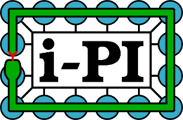
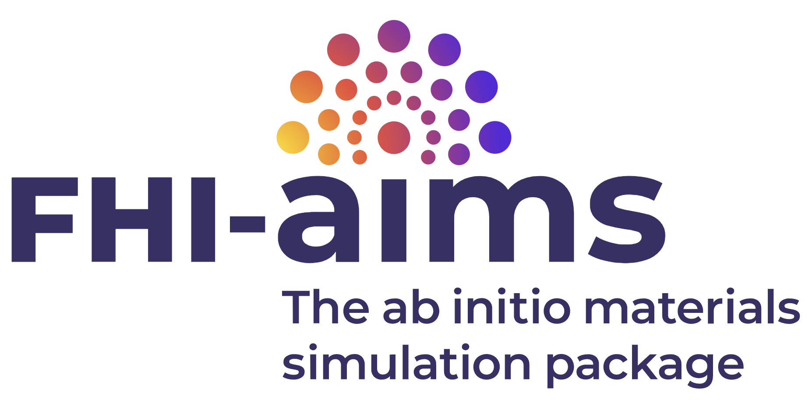

We are committed to developing and supporting open community software. The group contributes to the codes below, and Yair is one of the core developers of i-PI.

::: {.grid style="align-items: center;"}

::: {.g-col-12 .g-col-md-3 style="text-align: center;"}
[{width=220px}](https://ipi-code.org/)
:::

::: {.g-col-12 .g-col-md-9}
### [i-PI: a universal force engine](https://ipi-code.org/)

A Python engine for advanced molecular dynamics that obtains forces from external electronic-structure or machine-learning codes. It implements path-integral methods for nuclear quantum effects, quantum rate theories, and a broad set of sampling and dynamics schemes. Yair is one of the core developers and led the i-PI 3.0 release.
:::

:::

::: {.grid style="align-items: center;"}

::: {.g-col-12 .g-col-md-3 style="text-align: center;"}
[{width=240px}](https://fhi-aims.org/)
:::

::: {.g-col-12 .g-col-md-9}
### [FHI-aims: the ab initio materials simulation package](https://fhi-aims.org/)

An all-electron electronic-structure code based on numeric atom-centered orbitals, used for molecules, surfaces and materials. Our contributions concern the treatment of quantum nuclei, electron–phonon coupling and electronic friction, and the interface to i-PI.
:::

:::

::: {.grid style="align-items: center;"}

::: {.g-col-12 .g-col-md-3 style="text-align: center;"}
MetalWalls
:::

::: {.g-col-12 .g-col-md-9}
### [MetalWalls: a molecular dynamics code for electrochemical systems](https://gitlab.com/ampere2/metalwalls)

A classical molecular dynamics code dedicated to electrochemical systems, with constant-potential electrodes and polarizable force fields. We contribute developments for the simulation of electrified solid–liquid interfaces.
:::

:::
