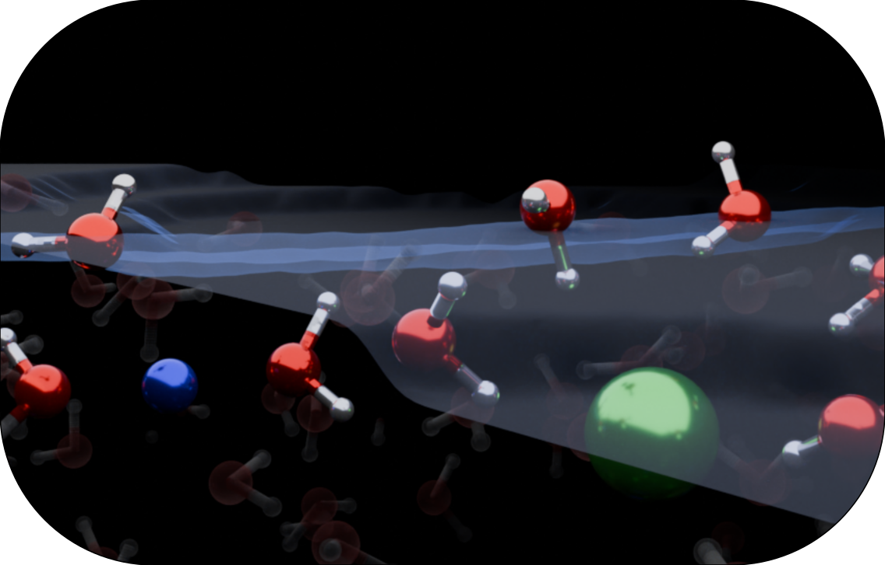

Where water meets the world: exploring the dynamic and complex realm of aqueous interfaces

<figure style="text-align: center;">
    
</figure>

Water covers more than 70% of the Earth's surface, and wherever it meets air, minerals or living matter, an aqueous interface forms. These interfaces regulate the climate and much of atmospheric chemistry, and they are at the heart of the technologies that will shape the energy transition. In batteries, fuel cells, electrolysers and supercapacitors, the reactions that matter take place within a few molecular layers of water in contact with an electrode.

It is now widely recognised that the structure of this interfacial water, how the molecules orient, hydrogen-bond and respond to the electric field at the electrode, has a strong influence on the performance of electrochemical devices. Its precise role, however, is still far from established. Electrified interfaces bring together an applied potential, mobile ions, a reactive solvent and a solid surface, and disentangling how these ingredients act together is a formidable challenge for both experiment and theory.

We tackle this challenge with a hierarchy of simulation methods, from classical force fields through ab initio density functional theory to machine-learning potentials, choosing the level of theory that the question demands. Our goal is to understand, at the molecular level, how interfacial water structure governs the properties of electrified interfaces, and to turn that understanding into design strategies for better materials.

## Related Publications

:::{#pubs}
:::
