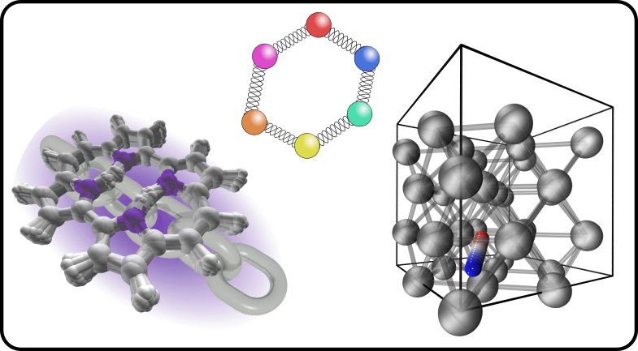

Understanding, predicting and manipulating nuclear quantum dynamics. 

<figure style="text-align: center;">
    
</figure>

Hydrogen is the third most abundant element in the Earth's crust by number of atoms, and water covers more than 70% of the planet's surface. Because the hydrogen nucleus is so light, its quantum nature does not fade away at room temperature: zero-point energy and tunnelling leave a measurable imprint on the structure, dynamics and reactivity of any material that contains it. This is particularly important for rate processes, where these effects can change the rate of a reaction by several orders of magnitude.

Our group uses methods based on the path-integral formulation of quantum mechanics, which make it possible to treat nuclei quantum mechanically in systems of hundreds or thousands of atoms. We develop and apply these methods to understand and predict the impact of nuclear quantum effects, with a particular focus on reaction rates. Our work spans both adiabatic processes, such as hydrogen transfer in molecules and water dissociation at surfaces, and non-adiabatic ones, for example, where the moving nuclei exchange energy with the electrons of a metal.

Our long-term ambition is to go from understanding and predicting nuclear quantum effects to manipulating them, turning the quantum nature of hydrogen from a complication into a design parameter.

## Related Publications

:::{#pubs}
:::
