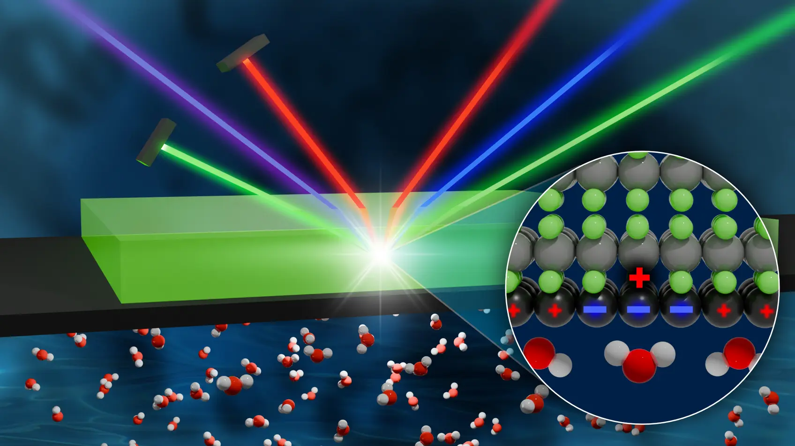

Using light to reveal the mysteries of molecular motion.

<figure style="text-align: center;">
    
</figure>

Vibrational spectroscopy is one of the most informative probes of aqueous systems. For example, the frequencies, intensities and lifetimes of the vibrational modes report on the local environment of each molecule and on the pathways along which energy flows. When studying interfaces, one important challenge is that only a handful of molecular layers matter, and their signal is buried under that of the bulk.

Our group specialises in surface-specific spectroscopies that solve this problem in two different ways. Sum-frequency generation (SFG) is a nonlinear optical technique that is blind to the bulk by symmetry: its signal comes only from regions where the inversion symmetry of the liquid is broken, that is, the interface itself. Tip-enhanced Raman spectroscopy (TERS) uses the sharp metallic tip of a scanning probe to amplify the Raman signal by many orders of magnitude, enough to resolve the vibrations of a single molecule.

We develop theory and algorithms to compute these observables from first principles, with higher accuracy and at lower computational cost. Decoding the spectroscopic signal is a fascinating problem in itself, but what drives us is that it provides a direct, quantitative link between our simulations and experiments.

## Related Publications

:::{#pubs}
:::
